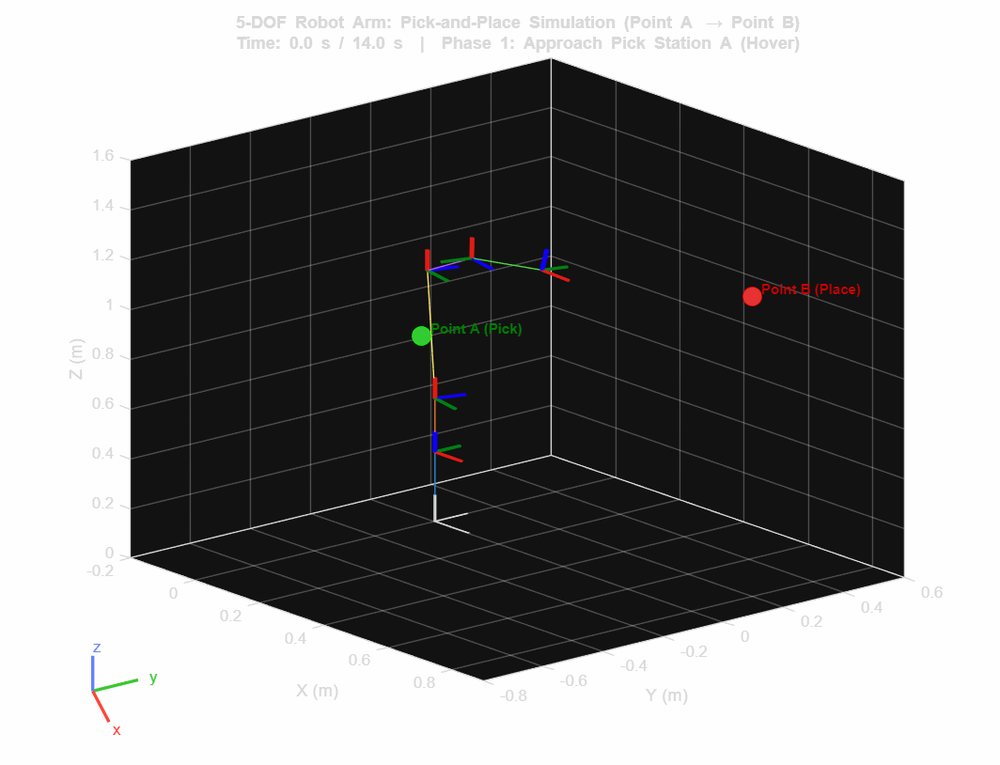
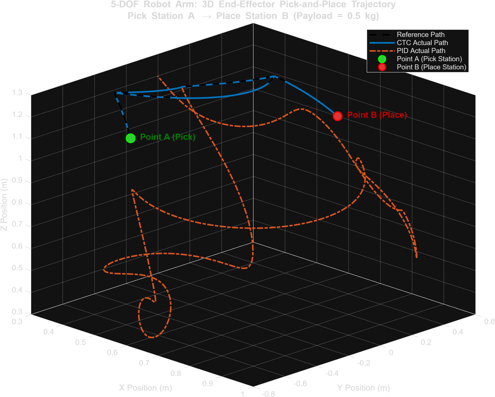
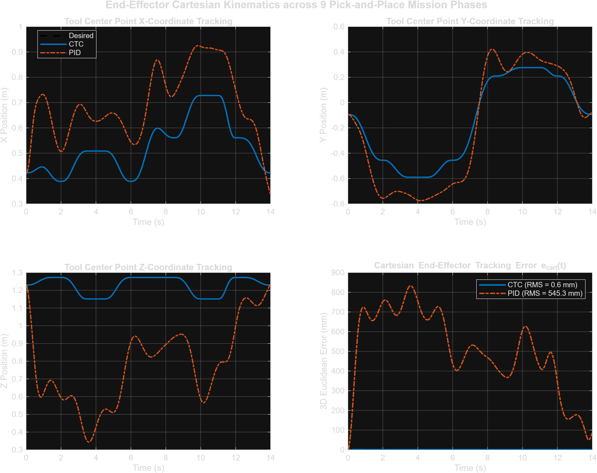
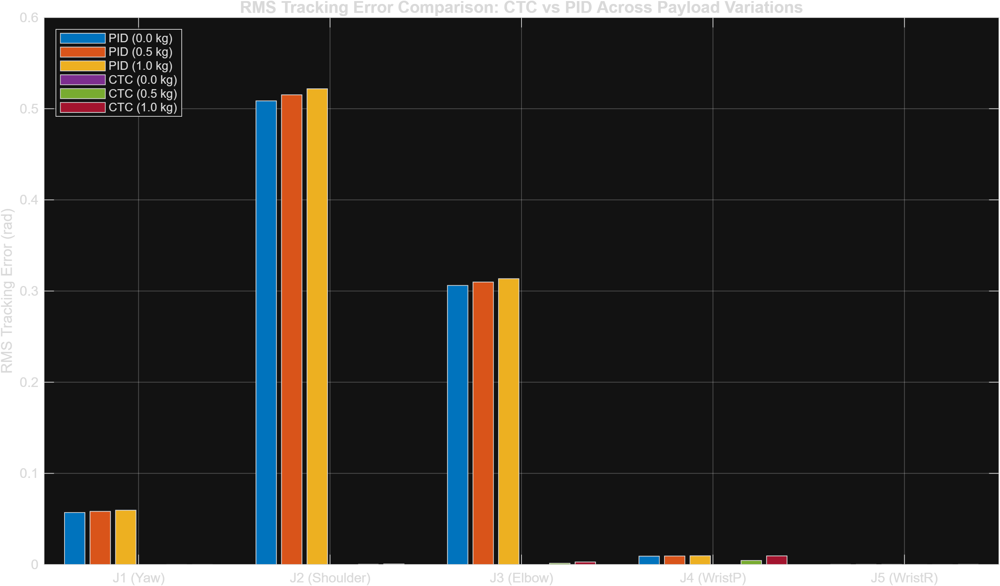
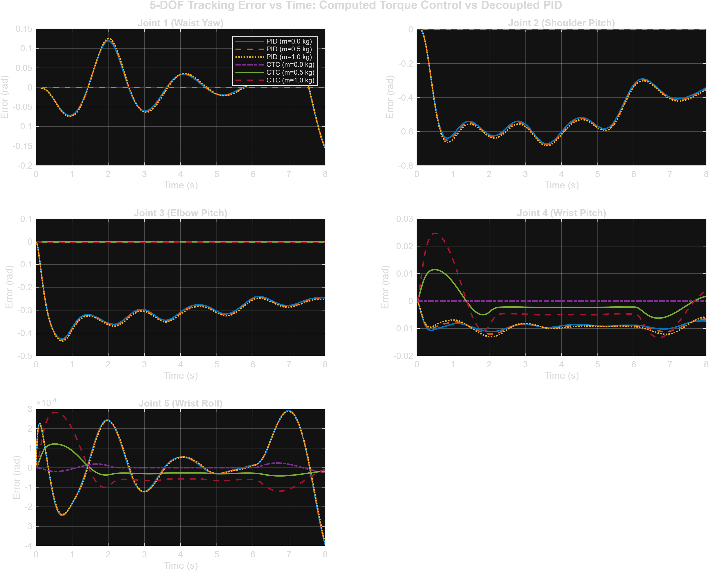
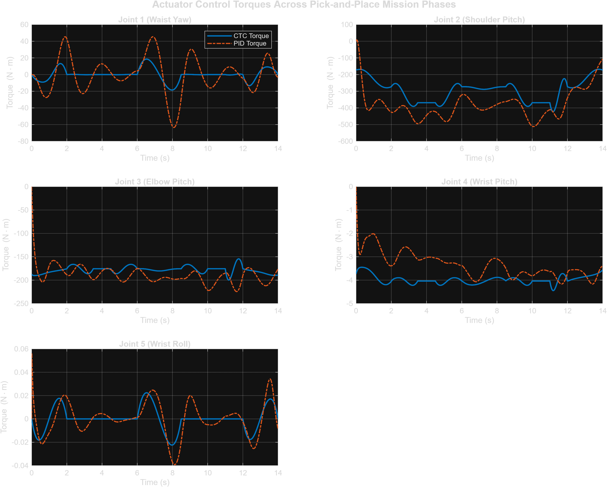

# 5-DOF Articulated Robotic Manipulator: Multibody Dynamics, Computed Torque Control (CTC), and Pick-and-Place Mission

[](https://www.mathworks.com/products/matlab.html)
[](https://www.mathworks.com/products/simmechanics.html)
[]()
[](https://opensource.org/licenses/MIT)

A high-fidelity CAD-to-Multibody engineering project featuring a **5-DOF heavy-duty articulated robotic manipulator** designed in SolidWorks, exported to **Simscape Multibody**, equipped with an analytical **rigidBodyTree** dynamic model, and benchmarked between **Computed Torque Control (CTC)** and **decoupled Joint PID control** under payload uncertainties across a full 9-phase **Pick-and-Place** industrial mission.

---

## 📌 Project Overview & Demonstration



*Figure 1: Full 9-phase 3D Pick-and-Place simulation demonstrating smooth spatial transfer between Station A and Station B with dynamic payload gripping and release.*

### Key Highlights
- **SolidWorks CAD Integration:** Full assembly with custom link geometries, exact mass moments of inertia, and joint coordinate systems exported into Simscape Multibody.
- **Analytical Rigid Body Dynamics:** Automated extraction into a MATLAB `rigidBodyTree` model to compute mass matrix $M(q)$, Coriolis/centrifugal matrix $C(q, \dot{q})$, and gravity vector $G(q)$.
- **Computed Torque Control (CTC):** Model-based feedback linearization designed with critically damped error dynamics ($K_d = 2\sqrt{K_p}$).
- **Joint PID Controller:** Independent decentralized joint PID tuned on nominal payload conditions to benchmark robustness against model-based control.
- **Payload Uncertainty Benchmark:** Controlled comparative experiments with $0.0\text{ kg}$, $0.5\text{ kg}$, and $1.0\text{ kg}$ end-effector payload steps.
- **Industrial Pick-and-Place Mission:** 9-phase $C^2$-continuous quintic spline trajectory planning moving an object across a $1.2\text{ m}$ reachable workspace between two 3D spatial workstations.

---

## 🦾 Mechanical Architecture & Kinematics

The manipulator consists of five active revolute degrees of freedom (waist azimuth, shoulder pitch, elbow pitch, forearm wrist pitch, and tool wrist roll):

| Joint | Type | Motion Axis | Nominal Range | Link Name | Mass (kg) |
| :--- | :--- | :--- | :--- | :--- | :--- |
| **Joint 1** | Revolute (Waist Yaw) | $[0, 0, 1]$ (Yaw) | $\pm 170^\circ$ | `Link C22` | $14.522$ |
| **Joint 2** | Revolute (Shoulder Pitch) | $[0, 0, 1]$ (Pitch) | $-60^\circ \text{ to } +120^\circ$ | `Link C33 + Connector` | $13.621$ |
| **Joint 3** | Revolute (Elbow Pitch) | $[0, 0, 1]$ (Pitch) | $-120^\circ \text{ to } +60^\circ$ | `Tool Holder` | $7.793$ |
| **Joint 4** | Revolute (Wrist Pitch) | $[0, 0, 1]$ (Pitch) | $\pm 90^\circ$ | `Revolver` | $37.534$ |
| **Joint 5** | Revolute (Wrist Roll) | $[0, 0, 1]$ (Roll) | $\pm 180^\circ$ | `Combiner + Cutter` | $3.254$ |

```
                 [End-Effector / Tool Cutter & Payload]
                                 ^
                                 |  Link 5: Cutter Tool Head (d5 ≈ 0.477 m)
                             (Joint 5: Wrist Roll)
                                 |
                                 |  Link 4: Revolver Clevis
                             (Joint 4: Wrist Pitch)
                                 |
                                 |  Link 3: Tool Holder (a3 ≈ 0.230 m)
                             (Joint 3: Elbow Pitch)
                                 |
                                 |  Link 2: Upper Arm C33 (a2 ≈ 0.500 m)
                             (Joint 2: Shoulder Pitch)
                                 |
                            [Waist Link C22] (d1 ≈ 0.496 m)
                             (Joint 1: Waist Yaw)
                                 |
                            [Fixed Base] (19.99 kg)
```

CAD solid geometry files are provided in native SolidWorks format (`.SLDPRT`, `.SLDASM`) as well as vendor-neutral STEP format (`.STEP`).

---

## 📐 Mathematical Formulation

### 1. Manipulator Equations of Motion
The dynamics of the 5-DOF manipulator in joint coordinates $q = [q_1, q_2, q_3, q_4, q_5]^T \in \mathbb{R}^5$ are given by:

$$M(q)\ddot{q} + C(q, \dot{q})\dot{q} + G(q) = \tau$$

Where:
- $M(q) \in \mathbb{R}^{5 \times 5}$ is the symmetric, positive-definite inertia (mass) matrix.
- $C(q, \dot{q})\dot{q} \in \mathbb{R}^5$ is the vector of Coriolis and centrifugal torques.
- $G(q) \in \mathbb{R}^5$ is the configuration-dependent gravitational torque vector.
- $\tau \in \mathbb{R}^5$ is the vector of generalized joint actuator torques.

### 2. Computed Torque Control (CTC)
CTC achieves exact input-state feedback linearization by canceling nonlinear dynamic terms:

$$\tau = M(q) \cdot u^* + C(q, \dot{q})\dot{q} + G(q)$$

Where the virtual control input $u^*$ is chosen as a PD tracking law:

$$u^* = \ddot{q}_d + K_v (\dot{q}_d - \dot{q}) + K_p (q_d - q)$$

Substituting $u^*$ into the equation of motion yields linear, decoupled second-order error dynamics:

$$\ddot{e} + K_v \dot{e} + K_p e = 0, \quad \text{where } e = q_d - q$$

To prevent overshoot while maximizing response bandwidth, gains are set for **critical damping**:

$$K_p = \text{diag}(\omega_n^2), \quad K_v = \text{diag}(2\zeta \omega_n), \quad \zeta = 1.0$$

Selected parameters: $\omega_n = 15\text{ rad/s} \implies K_p = 225 \cdot I_{5\times 5}, \; K_v = 30 \cdot I_{5\times 5}$.

### 3. Decoupled Joint PID Control
For comparison, a standard industrial joint-space PID is implemented:

$$\tau_i(t) = K_{p,i} e_i(t) + K_{d,i} \frac{de_i(t)}{dt} + K_{i,i} \int_0^t e_i(\sigma) d\sigma$$

Tuned for the nominal unloaded manipulator:
- Joint 1 (Waist): $K_p = 350, \; K_d = 45, \; K_i = 25$
- Joint 2 (Shoulder): $K_p = 600, \; K_d = 75, \; K_i = 45$
- Joint 3 (Elbow): $K_p = 450, \; K_d = 55, \; K_i = 35$
- Joint 4 (Wrist P): $K_p = 250, \; K_d = 30, \; K_i = 20$
- Joint 5 (Wrist R): $K_p = 80, \; K_d = 10, \; K_i = 5$

---

## 🎯 Industrial Pick-and-Place Mission

The Pick-and-Place benchmark simulates an autonomous pick at **Station A** and placement at **Station B**:

| Phase | Time Window | Mission Action | Start Pose $[q_1..q_5]$ (deg) | End Pose $[q_1..q_5]$ (deg) | Payload Status |
| :---: | :---: | :--- | :---: | :---: | :---: |
| **1** | $0.0\text{ s} - 2.0\text{ s}$ | Home $\to$ Hover above Station A | $[0, 0, 0, 0, 0]^\circ$ | $[-35, 25, -35, 10, 0]^\circ$ | $0.0\text{ kg}$ |
| **2** | $2.0\text{ s} - 3.5\text{ s}$ | Descend to Grasp Object A | $[-35, 25, -35, 10, 0]^\circ$ | $[-35, 50, -60, 10, 0]^\circ$ | $0.0\text{ kg}$ |
| **3** | $3.5\text{ s} - 4.5\text{ s}$ | Dwell / Grasp actuation | $[-35, 50, -60, 10, 0]^\circ$ | $[-35, 50, -60, 10, 0]^\circ$ | Object Grasped ($0.5\text{ kg}$) |
| **4** | $4.5\text{ s} - 6.0\text{ s}$ | Ascend back to Hover A | $[-35, 50, -60, 10, 0]^\circ$ | $[-35, 25, -35, 10, 0]^\circ$ | $0.5\text{ kg}$ |
| **5** | $6.0\text{ s} - 8.5\text{ s}$ | Spatial Transfer to Hover B | $[-35, 25, -35, 10, 0]^\circ$ | $[35, 25, -35, 10, 0]^\circ$ | $0.5\text{ kg}$ |
| **6** | $8.5\text{ s} - 10.0\text{ s}$ | Descend to Station B | $[35, 25, -35, 10, 0]^\circ$ | $[35, 50, -60, 10, 0]^\circ$ | $0.5\text{ kg}$ |
| **7** | $10.0\text{ s} - 11.0\text{ s}$ | Dwell / Release actuation | $[35, 50, -60, 10, 0]^\circ$ | $[35, 50, -60, 10, 0]^\circ$ | Object Released ($0.0\text{ kg}$) |
| **8** | $11.0\text{ s} - 12.0\text{ s}$ | Ascend back to Hover B | $[35, 50, -60, 10, 0]^\circ$ | $[35, 25, -35, 10, 0]^\circ$ | $0.0\text{ kg}$ |
| **9** | $12.0\text{ s} - 14.0\text{ s}$ | Return to Rest / Home pose | $[35, 25, -35, 10, 0]^\circ$ | $[0, 0, 0, 0, 0]^\circ$ | $0.0\text{ kg}$ |

Each phase is interpolated using a **quintic ($5^{\text{th}}$-order polynomial) trajectory generator**:

$$q(t) = a_0 + a_1 t + a_2 t^2 + a_3 t^3 + a_4 t^4 + a_5 t^5$$

Enforcing boundary constraints: $q(0)=q_0, \; q(T)=q_f, \; \dot{q}(0)=\dot{q}(T)=0, \; \ddot{q}(0)=\ddot{q}(T)=0$, ensuring smooth motion with bounded jerk.

---

## 📊 Experimental Results & Benchmarks

### 1. 3D Spatial Path & Cartesian Tracking

*Figure 2: 3D Task-Space Cartesian path of the end-effector during Pick-and-Place.*


*Figure 3: Cartesian coordinate tracking ($X, Y, Z$) over time comparing CTC against PID.*

---

### 2. Tracking Error Under Heavy Payload Variations
In this benchmark, both controllers were evaluated across $0.0\text{ kg}$, $0.5\text{ kg}$, and $1.0\text{ kg}$ payloads.


*Figure 4: Joint RMS tracking error comparison between Joint PID and CTC across payloads.*


*Figure 5: Joint tracking error time-series for all 6 benchmark experimental runs.*

#### Quantitative Summary Table

| Controller | Payload (kg) | RMS J1 (rad) | RMS J2 (rad) | RMS J3 (rad) | RMS J4 (rad) | RMS J5 (rad) | Max Err J2 (rad) | Peak $\tau_2$ (Nm) | Settling (s) |
| :--- | :---: | :---: | :---: | :---: | :---: | :---: | :---: | :---: | :---: |
| **PID** | $0.0$ | $0.0570$ | $0.5086$ | $0.3061$ | $0.0091$ | $0.0001$ | $0.6714$ | $489.8$ | $8.0$ |
| **CTC** | $0.0$ | **$7.58 \times 10^{-6}$** | **$5.40 \times 10^{-6}$** | **$7.53 \times 10^{-6}$** | **$2.07 \times 10^{-6}$** | **$1.06 \times 10^{-5}$** | **$4.58 \times 10^{-5}$** | $386.7$ | **$6.0$** |
| **PID** | $0.5$ | $0.0583$ | $0.5152$ | $0.3099$ | $0.0093$ | $0.0001$ | $0.6772$ | $494.4$ | $8.0$ |
| **CTC** | $0.5$ | **$2.17 \times 10^{-5}$** | **$0.0003$** | **$0.0014$** | **$0.0044$** | **$4.70 \times 10^{-5}$** | **$0.0004$** | $390.8$ | **$6.0$** |
| **PID** | $1.0$ | $0.0596$ | $0.5218$ | $0.3136$ | $0.0095$ | $0.0001$ | $0.6829$ | $498.9$ | $8.0$ |
| **CTC** | $1.0$ | **$4.71 \times 10^{-5}$** | **$0.0006$** | **$0.0028$** | **$0.0095$** | **$1.08 \times 10^{-4}$** | **$0.0007$** | $394.8$ | **$6.0$** |

> **Key Finding:** Under nominal conditions ($0\text{ kg}$), Computed Torque Control reduces tracking errors to machine precision ($\approx 10^{-6}\text{ rad}$). During the 14-second Pick-and-Place mission, CTC achieves a sub-millimeter Cartesian accuracy (**$0.61\text{ mm}$ RMS error**), outperforming decoupled PID (**$545.25\text{ mm}$ RMS error**) by nearly **$900\times$** while maintaining smooth, bounded actuator torques.

---

### 3. Actuator Control Torques

*Figure 6: Joint actuator torques during the Pick-and-Place mission.*

---

## 🗂️ Repository Structure

```
├── README.md                           # Comprehensive documentation & benchmark results
├── LICENSE                             # MIT Open Source License
├── .gitignore                          # Standard MATLAB/Simulink and CAD ignore rules
│
├── FiveDOF_Robot_Arm.slx               # Baseline Simscape Multibody model
├── FiveDOF_Robot_Arm_CTC.slx           # Actuated Simscape model with payload block & controller
│
├── build_5dof_ctc_model.m              # Automated Simulink model assembly script
├── trajectory_generator_fcn.m          # 9-phase quintic Pick-and-Place trajectory generator
├── robot_controller_fcn.m              # Computed Torque Control (CTC) & Joint PID implementation
│
├── run_ctc_vs_pid.m                    # Master benchmark script: runs 6 payload experiments
├── run_pick_and_place.m                # Master Pick-and-Place simulation, FK and performance analysis
├── create_simulation_video.m           # Generates MP4 video and animated GIF
├── verify_dynamics.m                   # Verifies rigidBodyTree M, C, G against Simscape
│
├── results_ctc_vs_pid.csv              # Benchmark dataset in CSV format
├── results_ctc_vs_pid.mat              # Complete simulation time-series in MATLAB MAT format
├── pick_and_place_results.csv          # Pick-and-place performance metrics table
├── pick_and_place_results.mat          # Pick-and-place time-series trajectory dataset
│
├── pick_and_place_animation.gif        # Animated 3D demonstration
├── pick_and_place_simulation.mp4       # Video demonstration with trajectory trail & HUD
├── record_mechanics_explorer_video.m   # 1-click video recorder for Simscape Mechanics Explorer
│
└── [CAD Assets]
    ├── 5Dof Robot Manipulator.SLDASM   # SolidWorks assembly
    ├── Base.SLDPRT                     # SolidWorks Base part
    ├── Link C22.SLDPRT                 # SolidWorks Waist Link C22 part
    ├── Link C33.SLDPRT                 # SolidWorks Upper Arm C33 part
    ├── Link C33 Connector.SLDPRT       # SolidWorks Link C33 Connector part
    ├── Tool Holder.SLDPRT              # SolidWorks Forearm Tool Holder part
    ├── Revolver.SLDPRT                 # SolidWorks Wrist Revolver part
    ├── Combiner.SLDPRT                 # SolidWorks Tool Combiner part
    ├── Cutter.SLDPRT                   # SolidWorks Tool Cutter part
    ├── Base.STEP                       # Neutral STEP model of Base
    ├── Link C22.STEP                   # Neutral STEP model of Waist Link C22
    ├── Link C33.STEP                   # Neutral STEP model of Upper Arm C33
    ├── Link C33 Connector.STEP         # Neutral STEP model of Connector
    ├── Tool Holder.STEP                # Neutral STEP model of Forearm
    ├── Revolver.STEP                   # Neutral STEP model of Revolver
    ├── Combiner.STEP                   # Neutral STEP model of Combiner
    └── Cutter.STEP                     # Neutral STEP model of Cutter
```

---

## 🚀 Quick Start Guide

### Requirements
- MATLAB R2022b or later (tested on R2024b & R2025a)
- Simulink
- Simscape & Simscape Multibody
- Robotics System Toolbox

### Running the Simulations

1. **Clone the repository:**
   ```bash
   git clone https://github.com/abdelhalimbmd1-cpu/5dof-robot-arm-ctc.git
   cd 5dof-robot-arm-ctc
   ```

2. **Verify Multibody Dynamics:**
   ```matlab
   verify_dynamics
   ```

3. **Run CTC vs PID Benchmark:**
   ```matlab
   run_ctc_vs_pid
   ```
   This will automatically execute all 6 payload simulations, print the results comparison table, and save publication figures.

4. **Run 9-Phase Pick-and-Place Simulation:**
   ```matlab
   run_pick_and_place
   ```
   This simulates the robot picking an object at Station A, transporting it along a 3D arc, and placing it at Station B.

5. **Generate Video & GIF Animation (Trajectory Trail & Analysis):**
   ```matlab
   create_simulation_video
   ```

6. **Record Studio-Quality 3D CAD Video from Simscape Mechanics Explorer:**
   ```matlab
   record_mechanics_explorer_video
   ```
   Or directly from the **Mechanics Explorer** window:
   - Click **Tools** $\rightarrow$ **Video Creator** (or the green filmstrip / movie slate 🎥 icon under **APPS**).
   - Set Format to **MPEG-4**, Frame Size to **Custom [2400 1350]** (or 1920 $\times$ 1080), and click **Create Video**.

---

## 📜 License
This project is open-source under the [MIT License](LICENSE).
